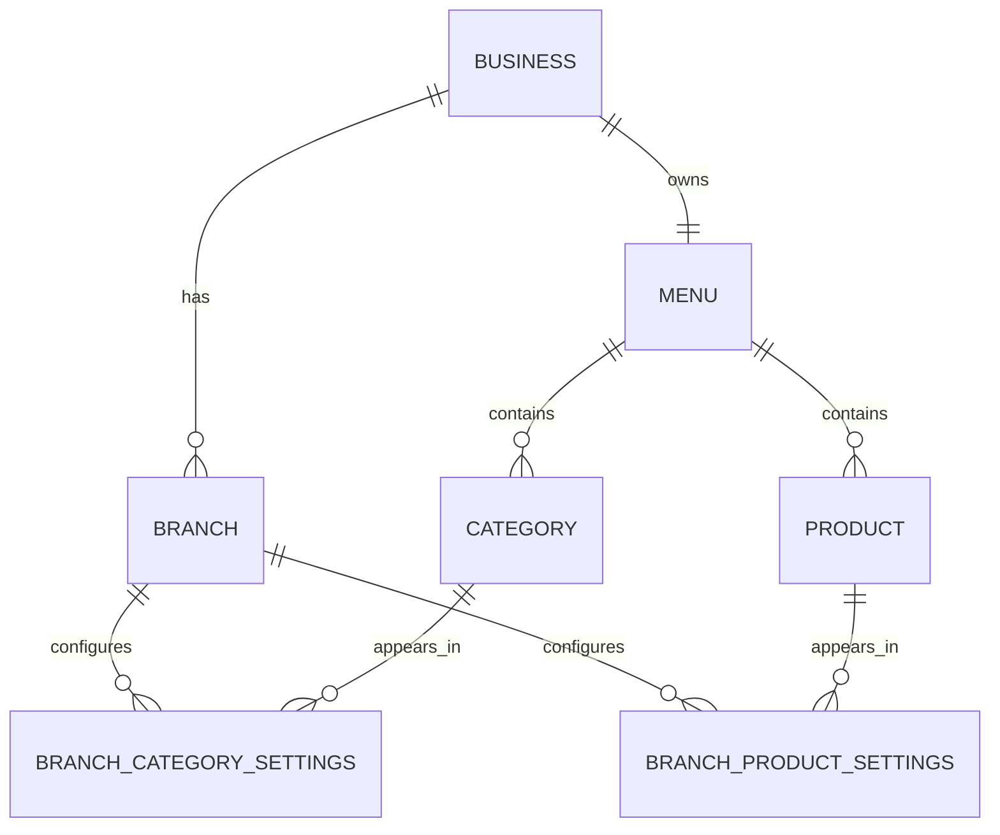

# Phase 9 — Branch Management: Data Model and Implementation Contract

- Status: Design approved; schema, lifecycle, and resolver foundation partially implemented
- Decision: ADR 0014
- Owner-approved model: Hybrid shared catalog with branch-level overrides
- Related issue: #64

## Goal

Allow each Business to operate multiple branches. Each branch has independent profile/contact/location, public menu identity and QR, product prices, availability/stock, product visibility/order, and optional product content overrides. Canonical catalog records remain shared by default.

## Domain model

### Tables

#### branches
- `id`: BIGINT PK
- `public_id`: unique ULID, identifier only
- `business_id`: FK to businesses
- `name`, `slug`, `status`, `is_primary`
- `phone`, `email`, `address`
- `latitude`, `longitude` (nullable pair)
- `timezone` (IANA identifier)
- `opening_hours` (nullable structured JSON validated by server)
- timestamps
- Unique `(business_id, slug)`, unique `(id, business_id)`
- Enforce one primary branch per Business with a cross-database-compatible design; test both PostgreSQL and SQLite.

#### branch_category_settings
- `id`: BIGINT PK
- `branch_id`, `business_id`, `menu_id`, `category_id`
- `is_visible`, `sort_order`, timestamps
- Unique `(branch_id, category_id)`
- Composite FKs prove branch, menu and category belong to the same Business/menu.

#### branch_product_settings
- `id`: BIGINT PK
- `branch_id`, `business_id`, `menu_id`, `product_id`
- `name_override`, `description_override`, `description_override_enabled`
- `base_price_override`, `discount_price_override`, `discount_override_mode` (inherit/set/clear)
- `is_visible`, `is_available`
- `track_inventory`, `stock_quantity`
- `sort_order`, timestamps
- Unique `(branch_id, product_id)`
- Composite FKs prove branch, menu and product belong to the same Business/menu.

## Effective value rules

| Field | Effective value |
|---|---|
| Name | name_override, else Product.name |
| Description | description_override when enabled (including intentional null), else Product.description |
| Base price | base_price_override, else Product.base_price |
| Discount | override set / clear / inherit according to discount_override_mode |
| Availability | canonical publishable status AND branch is_visible AND branch is_available AND (inventory not tracked OR stock_quantity > 0) |
| Category | branch category visibility and branch category sort order |
| Product order | branch sort_order, with deterministic canonical fallback |

All resolution must happen in one domain service/resolver. Do not duplicate fallback rules in controllers or Vue.

## Defaulting and synchronization

- Backfill one primary branch for every existing Business.
- Backfill visible branch category/product settings for all existing categories/products.
- New branch: initialize visible assignments for all current categories/products with inherited fields.
- New canonical product/category: initialize visible settings for all active branches.
- Canonical updates never overwrite explicit branch overrides.
- Explicit branch exclusion/visibility changes must survive subsequent canonical edits.
- All multi-row assignment and entitlement-sensitive writes are transactional.

## Important schema and data-integrity rules

- Retain current Business -> Menu -> Category/Product canonical ownership.
- Carry business_id/menu_id on branch setting rows only as composite-FK ownership witnesses; never accept them from client input.
- Enforce same-tenant/same-menu relationships using composite foreign keys, not only Eloquent validation.
- Internal keys BIGINT; public IDs ULID; ULIDs never authorize access.
- Branch count uses existing EntitlementService/EnforcementService; primary branch counts toward max_branches.
- Money remains integer Toman.
- Stock count is informational/manual in Phase 9. No order reservation or automatic deduction.
- No product image override in Phase 9; media is Phase 10.
- No translations in Phase 9; locale overrides are Phase 12.
- Public-menu cache key and invalidation must include branch identity.

## Migration and rollout sequence

1. Add branches table and branch settings tables with unique/composite constraints.
2. Add one primary branch per existing Business; use deterministic branch name/slug policy and collision-safe slug generation.
3. Backfill category/product settings for each primary branch.
4. Verify counts and same-tenant ownership in staging.
5. Add branch-aware read path while retaining legacy public route as explicit primary-branch compatibility behavior.
6. Add branch-aware public URLs and QR generation.
7. Enable additional branch creation behind server-side entitlement checks.
8. Remove legacy route only in a later, separately reviewed change after owner acceptance.

The migration must be idempotent/retry-safe at the backfill layer, tested on a production-like database copy, and must not be run destructively against live Production during QA.

## Required test groups

- Migration/backfill: existing businesses, zero-product businesses, many-product businesses, rerun/retry behavior.
- Composite FK: branch/product/category from different businesses or menus is rejected.
- Tenant IDOR: foreign branch IDs and public ULIDs cannot access management operations.
- Entitlements: max_branches and concurrent creation at the final slot.
- Inheritance: base changes flow only to non-overridden values.
- Overrides: name, description including clear-to-null, base price, discount inherit/set/clear.
- Branch operations: profile, category visibility/order, product visibility/availability/stock/order.
- Public menu: branch URL, QR resolution, inactive branch, cache key and invalidation.
- PostgreSQL: real lock/concurrency and FK tests.
- E2E: owner creates second branch, customizes its menu, scans its QR, and confirms first branch remains unchanged.

## Out of scope

- Orders, POS, reservations, warehouse management, stock movement ledger, automatic stock deduction.
- Per-branch media assets (Phase 10).
- Per-branch translation overrides (Phase 12).
- Multiple independent canonical menus per Business.
